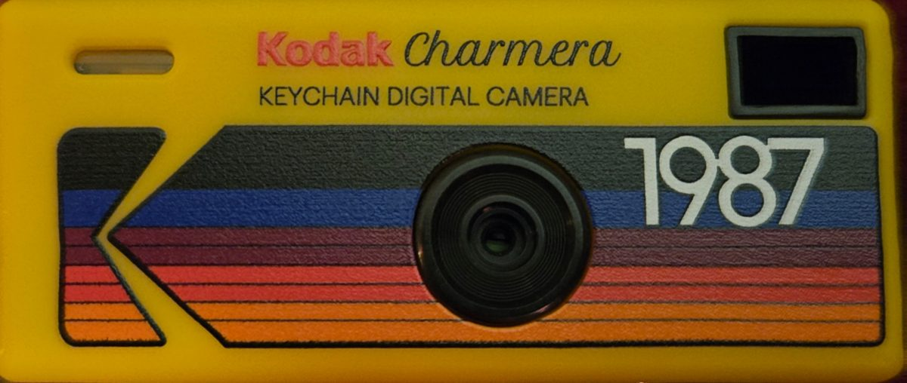
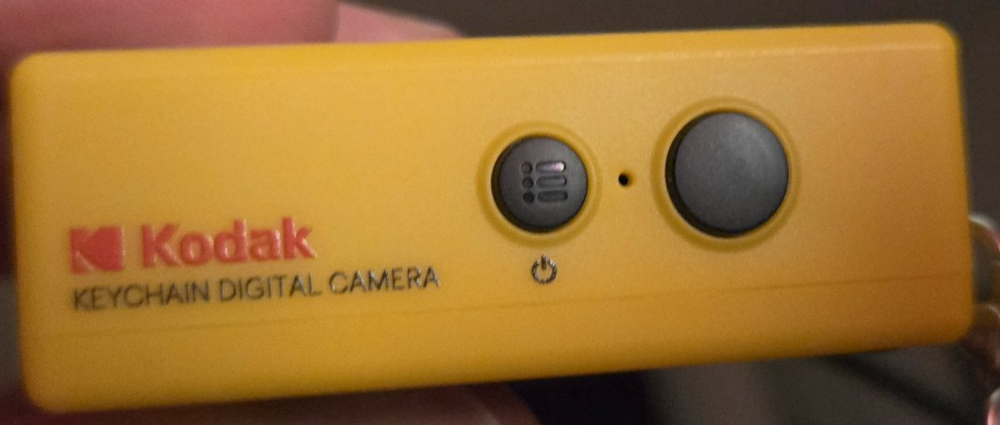
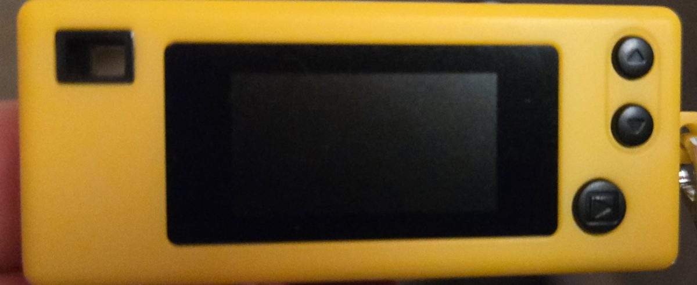
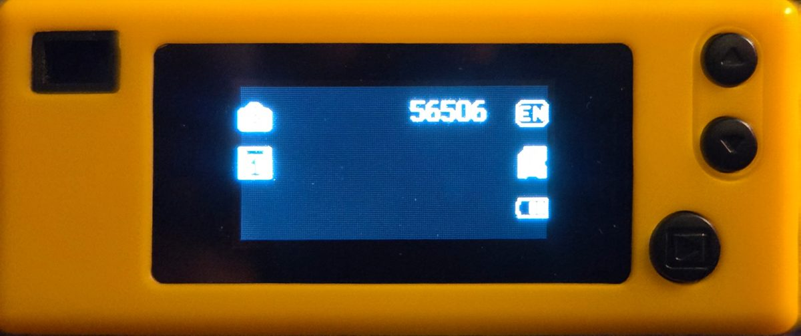
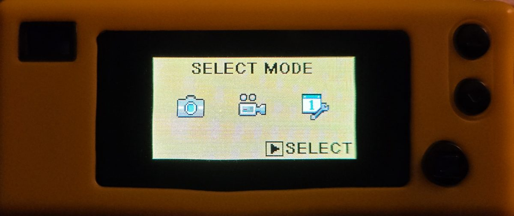
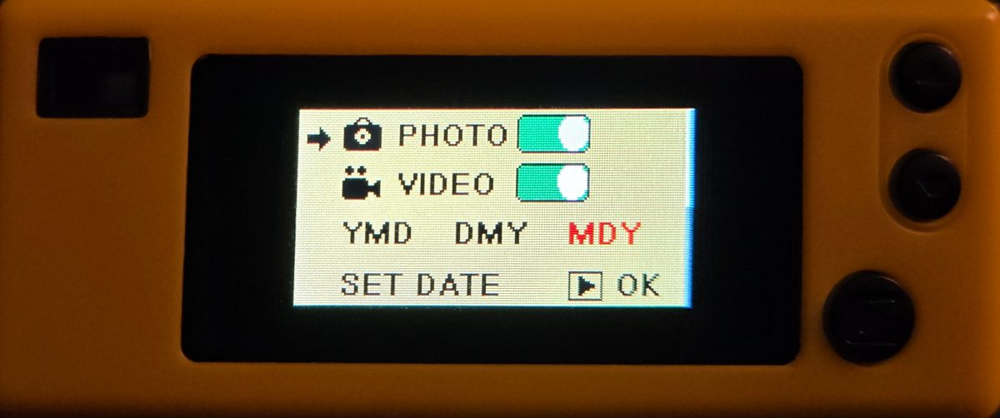
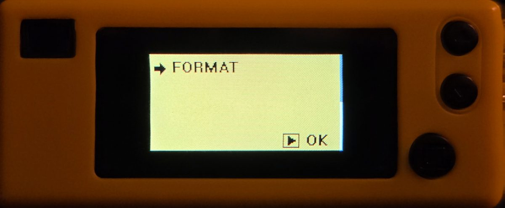

# The camera's buttons and screens

Photos of a stock Kodak Charmera (original 2025 series), taken by its owner on 2026-11-11, with what each control
does. Check here what the camera really has before you assume a button, menu or setting exists. Firmware text and
SDK code often name items the camera never shows. The photos carry no metadata.

## Front

The lens is in the middle. The small horizontal window at top left is the flash LED. It lights only in dim light,
when the exposure code flags low light at the shutter press. The viewfinder window is at top right.

## Buttons

On the top edge, from left to right:

- the menu/power button (three lines, power symbol under it);
- a small hole (not identified);
- the large shutter button.

The back has the viewfinder (top left) and the screen. On the right, from top to bottom: Up, Down and Play/OK (a
square with a triangle).

Holding Up in photo mode changes the menu language. The language is byte +0x00 of the settings record, which the
firmware reads as the index into its language table, and a change is saved as a new record
([Image layout](11-FORMAT.md)). The "EN" badge on the photo screen shows it.

## Screens

Photo mode shows the camera icon, a mode icon at left, the shots-remaining count, the language badge, the card icon
and the battery.

Home (SELECT MODE) has three choices: photo, video and setup (calendar with a wrench). Play/OK selects.

Setup, page 1 has these rows:

- PHOTO: date stamp on photos, on or off.
- VIDEO: date stamp on videos, on or off.
- YMD / DMY / MDY: the date format. The chosen one is red.
- SET DATE: sets the clock.

Setup, page 2 has only FORMAT.

These are the 7 items of the firmware's setup list, in order: PHOTO, VIDEO, YMD, DMY, MDY, the date item and FORMAT.
In the stock dump the list is at VA 0xFFBF2. The firmware calls the date item "OK", and the screen shows it as SET
DATE. The three date formats share one line, so page 1 holds six items and page 2 holds FORMAT.

## Telling builds apart on the camera

The photos above show a stock camera. Two things on the camera say something about the firmware it runs, and one
says nothing.

If setup page 2 has Volume and LED rows after FORMAT, one of our mods (v0.24 or later) is installed. The stock builds
have FORMAT alone there ([v0.24's rows](15-OV9732-AE-WB-FLASH-PORT.md)).

If Photo or Video mode freezes after a flash, the firmware doesn't drive this camera's sensor. It's a build for the
other sensor family (seen with an SP140A build on an OV9732 camera). Photos from before that flash say what fits. A
photo from after it shows only the firmware that took it.

Setup > Version shows `JH5408  20250520` on every known build (v006, v008_test, v012 and ours all carry the same
string), so it tells you nothing. This screen isn't in the photos above.

The photos on the card say more. The app's "Identify this camera's firmware" route reads their headers
([Android app](06-ANDROID.md#identify-this-cameras-firmware)).

Back to the [documentation index](README.md).
